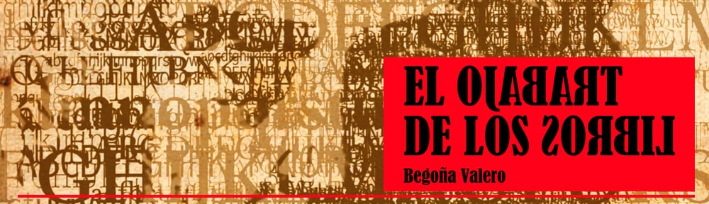

La muerte de un joven en una residencia de estudiantes de Maguncia en Alemania, hace recordar a uno de los sospechosos, David Grau, un «Erasmus» de periodismo, todo lo sucedido desde su llegada a la ciudad.

Es el punto de partida de un relato que conduce al lector hasta la Edad Media, donde adquiere especial relevancia la vida de Gutenberg, el inventor de la imprenta, cuya existencia está salpicada de vicisitudes que contribuyen a crear un ambiente de lucha constante por conseguir su objetivo secreto: la estampación de libros con «letras de molde».

La situación social, política y económica del siglo XV está presente en todas las actuaciones del insigne inventor. Ambas historias, pasada y actual, consiguen influenciarse de tal manera que no se puede entender una sin la otra.

## La portada

La imagen de portada es obra de Paco Roca, Premio Nacional del Cómic 2008 por *Arrugas*, que además cuenta con dos Premios Goya a la mejor película de animación y al mejor guion adaptado en 2012, y de Raquel Silvestre. También ha participado en el diseño gráfico de la portada el artista creativo MacDiego.
